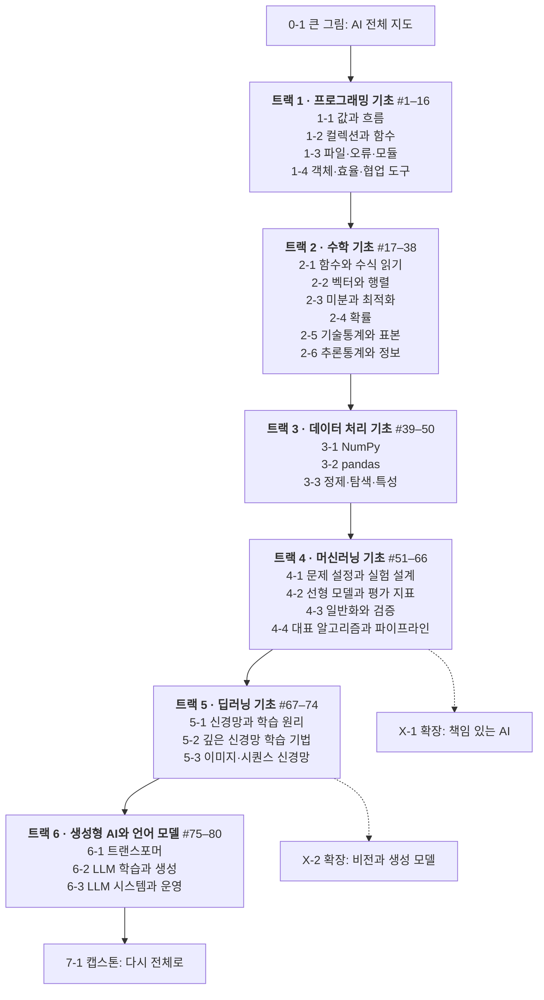

# AI 커리큘럼 탑다운 재구성 플랜

[문서 홈](../README.md) · [현재 커리큘럼 목차](../curriculum/README.md) · [부록: 기존 104단계 재배치표](top-down-curriculum-mapping.md)

> 상태: **제안 — 아직 구현하지 않음.** 2026-11-02의 `src/content` 원본(4부·8주·104단계)을 80개 AI 개념 목록과 대조해 작성했다. 현재 학습 시간은 사이트의 예상 시간 계산식(`src/content/sections.ts`)으로 얻은 값이고, 새 레슨의 시간은 추정치다.

## 요약

- **구조:** 「4부 · 8주 · 단계」를 「6트랙 · 25모듈 · 레슨」으로 바꾼다. 맨 앞에 큰 그림(0-1), 맨 끝에 캡스톤(7-1)을 둔다. 80개 개념은 모두 필수(핵심) 레슨이 된다. 주차는 콘텐츠 단위에서 빼서 기수 일정표로만 쓴다.
- **진단:** 80개 중 42개는 기존 내용을 나누고 옮기면 된다(●). 27개는 보강(◐), 11개는 새로 써야 한다(○). 보강·신규 38개 중 35개가 프로그래밍·수학·데이터 3트랙에 있다. 이 3트랙은 개념 수의 62%(50/80)인데, 지금은 핵심 학습 시간의 14%(약 4.5시간)만 받는다.
- **상위 트랙은 이미 충실하다.** 머신러닝·딥러닝·생성형 AI(30개 개념)는 30개 중 27개가 ●다. 이 트랙의 일은 주차 단위로 묶인 단계를 개념 단위 레슨으로 나눠 재배치하는 것이다.
- **사이트:** 개념 선수관계를 데이터로 만든다. 그 데이터로 커리큘럼 지도, 트랙 진단과 건너뛰기, 목표 기반 경로, 레슨 시작의 준비 점검을 제공한다.
- **데이터 이전:** 확인 문제·서술형·실습 ID가 전 주차에서 전역 고유하다. 그래서 진도를 문항 단위로 옮길 수 있다. 과제 제출물은 옮기지 않고, 이어받는 모듈이 기존 저장 키를 그대로 쓴다.
- **순서:** 골격 데이터·검증 → 원본을 레슨 파일로 기계 분리 → 새 정보 구조와 이전 도구 → 기초 트랙 작성·상위 트랙 재배치(병렬) → 진단·경로 → 기수 경계에서 전환.

## 1. 진단: 현재 커리큘럼과 80개 개념

### 1.1 현재 구조

| 항목 | 현재 |
| --- | --- |
| 구성 | 4부 · 8주 · 104단계(핵심 54 · 보충 25 · 심화 25) |
| 예상 학습 시간 | 핵심 약 33시간 · 보충 약 13시간 · 심화 약 10시간 |
| 평가 | 확인 문제 541 · 서술형 223 · TODO 실습 105 · 추가 퀴즈 153 · 백지공부 40문항 · 과제 8 |
| 진도 저장 | `learning_items(user_id, kind, week_slug, item_id)`, 과제 `submissions(user_id, week_slug)` |
| ID | 단계 104 · 확인 문제 541 · 서술형 223 · 실습·과제 심화 문제 121 · 추가 퀴즈 153이 모두 전역 고유(중복 0) |

### 1.2 80개 개념 기준 커버리지

판정 기준은 다음과 같다. **●**: 그 개념을 직접 가르치는 단계가 있다(보충·심화에 있으면 핵심으로 올린다). **◐**: 다른 단계 속 몇 문단이거나 심화의 유도로만 다룬다. 핵심 수준으로 다시 써야 한다. **○**: 가르치는 단계가 없다. 개념별 판정은 [3.4](#34-트랙별-모듈과-레슨), 기존 단계별 행선지는 [부록](top-down-curriculum-mapping.md)에 있다.

| 트랙 | 개념 | ● | ◐ | ○ | 지금 핵심 경로의 시간 |
| --- | ---: | ---: | ---: | ---: | --- |
| 1 프로그래밍 기초 | 16 | 4 | 9 | 3 | 약 1.3시간(1.3 · 3.3) |
| 2 수학 기초 | 22 | 8 | 9 | 5 | 약 1.7시간(1.5 · 1.6 · 1.7) |
| 3 데이터 처리 기초 | 12 | 3 | 6 | 3 | 약 1.5시간(1.4 · 2.1 · 2.2) |
| 4 머신러닝 기초 | 16 | 14 | 2 | 0 | 약 4.3시간 |
| 5 딥러닝 기초 | 8 | 8 | 0 | 0 | 약 7.2시간 |
| 6 생성형 AI와 언어 모델 | 6 | 5 | 1 | 0 | 약 13시간 |
| 합계 | 80 | 42 | 27 | 11 | 29시간(+ 1.1 지형도와 8주차 위험·거버넌스·연구·캡스톤 약 4시간) |

신규(○) 11개: #7 가변·불변 객체와 참조·복사, #10 파일 입출력, #14 자료구조와 시간복잡도, #17 함수·정의역·치역·합성, #18 일차·이차·지수·로그 함수, #19 시그마와 수열, #33 표본·모집단·표본편향, #35 공분산·상관·인과, #43 데이터 불러오기·조회·필터링·정렬, #44 그룹 집계·결합·형태 변환, #47 히스토그램·산점도·상자그림·상관행렬.

### 1.3 구조 문제

1. **기초 압축.** `python-basics` 한 단계(45분)가 프로그래밍 개념 9개를 맡는다. `gradient-descent` 한 단계(45분)는 미분 개념 4개를 맡는다. 1주차 핵심 7단계에 80개 중 26개 개념이 들어 있다.
2. **기초가 선택 과정에 있다.** 80개 목록에서 기초인 다음 내용이 지금은 보충이다: 가상환경·Git(1.9), 클래스·예외(1.8), 행렬곱·기저(1.10), 정규분포(1.11), KNN(2.9), K-means·PCA(2.10), 하이퍼파라미터 탐색(2.11), PR 곡선·불균형(2.12), BatchNorm·LayerNorm(3.8), 드롭아웃(3.10). 우도·엔트로피(1.13·1.14)와 신뢰구간·가설검정(2.15·7.12)은 심화의 유도로만 나온다.
3. **주차가 네 역할을 겸한다.** 주차 하나가 콘텐츠 묶음, 일정(마감일), 진도 저장 키, 과제 저장 키를 모두 맡는다. 그래서 단계 하나를 다른 주로 옮기면 네 가지가 함께 흔들린다.
4. **선수관계가 문장으로만 있다.** 「선수지식과 개념 연결」 네 줄이 전부라 경고·진단·경로 계산에 쓸 수 없다. 반대로 본문에는 위치가 하드코딩되어 있다. 「N주차」 참조가 본문 172곳(72개 단계)과 문항·실습·과제 48곳, 「…」 단계 참조가 129곳이다. 재배치하면 모두 틀어진다.
5. **진입점이 하나뿐이다.** 누구나 1주차 1단계부터 시작한다. Python을 아는 사람은 건너뛸 근거(진단)가 없다. 처음 배우는 사람은 한 단계에서 개념 9개를 한꺼번에 만난다.
6. **학습 자료 코드 셀이 그림을 버린다.** 워커(`public/pyodide-worker.js`)는 matplotlib 그림을 PNG로 돌려준다. 그런데 `src/components/CodeCell.tsx`가 이를 표시하지 않는다(실습·과제 화면은 표시한다). 시각화 레슨(#47)을 넣으려면 먼저 고쳐야 한다.
7. **80개 밖의 핵심 단계가 있다.** 6.2 BERT·GPT·T5, 6.3 스케일링 법칙, 8.1 위험 지도, 8.2 공정성은 지금 핵심이지만 80개 목록에는 없다([6절](#6-결정할-것)).

### 1.4 유지할 것

- 레슨 진행 형식: 학습 → 실습 → 확인 문제(서버 채점) → 완료. 핵심·보충·심화 구분, 브라우저 실습 자동 채점, 백지공부, 루브릭 과제, 운영자 재실행 채점도 유지한다.
- 전역 고유 ID와 `validate:content`·`check:labs`·`docs:check` 검증 체계.
- 상위 트랙의 설계: 직접 구현(micrograd·attention), 검증(gradient check·causal test), 평가(골든셋)를 그대로 옮긴다.
- [지난 교육 설계 검토](../archive/design/learning-content-educational-review.md)의 권고: 필수 경로는 좁히고 피드백 고리는 촘촘히, 캡스톤 마일스톤은 앞으로 분산.

## 2. 이 플랜에서 '탑다운'의 뜻

| 층 | 뜻 | 사이트에 나타나는 모습 |
| --- | --- | --- |
| 설계 | 수료 목표 → 트랙 → 모듈 → 레슨 → 확인 문제·실습 순서로 정한다. 각 단위는 윗단위 목표에 쓰일 때만 둔다. | 레슨마다 "이 개념이 쓰이는 곳"(윗단위로 가는 링크)이 데이터로 있다 |
| 학습 | 전체 → 부분 → 다시 전체. 완성품과 목표 문제를 먼저 보고, 필요한 개념을 배운 뒤, 문제로 돌아온다. | 0-1 큰 그림, 트랙 지도, 모듈 목표 문제, 트랙 프로젝트, 캡스톤 |
| 경로 | 목표 개념을 고르면 선수 개념을 거꾸로 따라가 개인 경로를 만든다. 이미 아는 것은 진단으로 건너뛴다. | 진단·인정, 목표 기반 경로, 준비 점검 |

설명 순서는 선수관계를 따른다(프로그래밍 → … → 생성형 AI). LLM부터 설명하면 동기는 생기지만, 설명에 쓸 언어(벡터·확률·미분)가 아직 없어 이해가 얕아진다. 그래서 큰 그림은 먼저 보여 주고, 설명은 아래에서 위로 쌓는다.

## 3. 새 커리큘럼

### 3.1 계층과 용어

| 현재 | 제안 | 설명 |
| --- | --- | --- |
| 부(4) | 트랙(6) + 오리엔테이션 · 캡스톤 · 확장 | 80개 개념의 여섯 분류를 그대로 쓴다 |
| 주차(8) | 모듈(25) + 확장 모듈(2) | 콘텐츠·진도·백지공부·과제의 단위. 개념 2~6개 |
| (주차에 포함) | 일정(기수별 운영 설정) | "몇째 주에 어느 모듈"과 마감일만 정한다 |
| 단계(104) | 레슨(핵심 104 · 보충·심화 37 · 확장 11) | 핵심 레슨 하나는 20~40분. 핵심 레슨이 80개 개념을 모두 덮는다 |
| 핵심·보충·심화 | 그대로 | 핵심 = 개념 레슨(모듈 완료 조건). 보충·심화 = 같은 모듈의 선택 깊이 |

모듈은 「트랙-순서」(예: 2-3), 레슨은 개념 번호(예: #25)로 부른다. 범위가 큰 개념 10개(#68·#70·#71·#73·#74·#76·#77·#78·#79·#80)는 핵심 레슨 2~5개로 나눈다. 나머지 70개는 레슨 하나씩이다. 여기에 0-1(2개)과 7-1(3개)을 더해 핵심 레슨은 104개다.

### 3.2 수료 목표(맨 윗단위)

1. 파이썬으로 데이터를 읽고·정리하고·분석하는 코드를 재현 가능하게 작성한다. (트랙 1·3)
2. 모델·손실·학습을 함수·벡터·미분·확률·통계의 언어로 설명하고 손으로 계산한다. (트랙 2)
3. 머신러닝 문제를 누수 없이 설계하고, 기준 모델과 알맞은 지표로 결과를 판단한다. (트랙 4)
4. 신경망·역전파·Self-Attention을 직접 구현하고, 학습 실패를 진단한다. (트랙 5·6)
5. LLM이 학습·생성되는 과정과 한계를 설명한다. RAG·도구·에이전트 시스템을 만들고 평가·운영 지표로 검증한다. (트랙 6)
6. 자기 프로젝트의 위험을 점검하고 모델카드로 보고한다. (캡스톤, 깊이는 확장 X-1)

### 3.3 트랙·모듈 지도

위에서 아래로 기본 경로 순서다. 트랙 안의 모듈도 적힌 순서대로 진행한다. 점선은 선택 확장이다.



트랙을 넘는 주요 선수관계는 다음과 같다. 개념 단위의 전체 선수관계는 P1에서 `concepts.ts`로 만든다([5절](#5-실행-로드맵)).

| 모듈 | 먼저 끝낼 모듈 | 이유 |
| --- | --- | --- |
| 2-1 | 1-2 | 수식을 파이썬 코드로 확인한다 |
| 3-1 | 2-2 | 배열은 벡터·행렬이다 |
| 3-2 | 1-3 | 표를 파일에서 읽는다 |
| 3-3 | 2-5 | 분포·이상치를 기술통계로 판단한다 |
| 4-1 | 2-3, 3-3 | 학습은 손실 최소화이고, 입력은 준비된 특성이다 |
| 4-2 | 2-6 | 로지스틱 회귀의 손실은 교차엔트로피다 |
| 4-4 | 2-2, 2-5 | PCA는 벡터와 공분산으로 설명한다 |
| 5-1 | 1-4, 2-3, 4-2 | 자동미분 엔진은 클래스로 만들고, 역전파는 연쇄법칙이며, 뉴런 하나는 로지스틱 회귀다 |
| 5-2 | 2-4 | 초기화는 분산 계산이다 |
| 6-1 | 2-2, 5-3 | Attention은 내적·행렬곱이고, RNN의 한계에서 출발한다 |
| 6-2 | 2-4, 2-6 | 생성은 샘플링이고, 사전학습 손실은 교차엔트로피·perplexity다 |
| 6-3 | 1-3, 1-4, 4-2 | 도구 호출은 JSON, 벡터 검색은 시간복잡도, 평가는 지표 선택이다 |

### 3.4 트랙별 모듈과 레슨

표의 "원본"은 기존 단계 번호(1.3 = 1주차 3단계)이고, 「」 안은 그 단계의 소제목(콜론 앞부분)이다. 표에 없는 기존 단계의 행선지는 [부록](top-down-curriculum-mapping.md)에 있다. 시간은 추정치다.

#### 트랙 0 · 큰 그림

**0-1 AI 전체 지도** · `orientation` · 약 1시간 — 목표 문제: 과정 끝에 만들 「스터디 자료 QA 봇」의 완성 예시를 먼저 실행해 보고, 그 안에 든 여섯 트랙의 부품을 지도에서 찾는다.

| 레슨 | 원본 | 상태 | 작업 |
| --- | --- | --- | --- |
| AI·머신러닝·딥러닝·생성형 AI 지도, "함수를 찾는 게임" | 1.1 | ● | 각 부분이 어느 트랙·개념 번호에서 다뤄지는지 연결 |
| 완성품부터 만져 보기 | — | ○ | 브라우저 10줄 실습: 데이터 읽기 → 특성 준비 → 학습 → 평가 → 작은 문자 모델의 다음 글자 확률. 줄마다 개념 번호 배지 |

트랙 진단과 경로 선택은 레슨이 아니라 `/start` 화면에서 한다([3.8](#38-경로진단일정)).

#### 트랙 1 · 프로그래밍 기초(#1–16) · 핵심 16레슨 · 약 6~7시간

왜: 모든 실습·과제·도구 호출이 파이썬 코드다. 트랙 프로젝트: 신규 「학습 기록 분석기」(CSV·JSON 읽기 → 함수·클래스로 요약 → 오류 처리 → 결과 저장, Git 이력과 재현 기록 포함).

**1-1 값과 흐름** · `python-flow` — 목표 문제: 퀴즈 점수 목록으로 합격 여부와 등급을 판정한다.

| 레슨 | 원본 | 상태 | 작업 |
| --- | --- | --- | --- |
| #1 변수와 값, 자료형, 형 변환 | 1.3 일부 | ◐ | `type()`, `int()`·`float()`·`str()` 변환과 변환 오류. 오류 메시지 읽기를 맛보기로(1.3 「오류 메시지 읽는 법」) |
| #2 숫자·문자열·불리언과 기본 연산 | 1.3 일부 | ◐ | `//`·`%`·`**`, 문자열 메서드·f-string, 부동소수점 오차 |
| #3 비교 연산, 논리 연산, 조건문 | 1.3 일부 | ◐ | `and`·`or`·`not`, 단락 평가, 참으로 취급되는 값 |
| #4 반복문과 반복 제어 | 1.3 일부 | ◐ | `break`·`continue`, 중첩 반복, 누적 패턴 |

**1-2 컬렉션과 함수** · `python-collections-functions` — 목표 문제: 문장 목록에서 단어 빈도 사전을 만든다(토큰화의 앞 단계).

| 레슨 | 원본 | 상태 | 작업 |
| --- | --- | --- | --- |
| #5 리스트, 튜플, 딕셔너리, 집합 | 1.3 「자료구조 넷」, 3.3의 `set` | ● | |
| #6 인덱싱과 슬라이싱 | 1.3 일부 | ◐ | 음수 인덱스·step·중첩 리스트. NumPy 인덱싱(#40) 예고 |
| #7 가변·불변 객체, 참조와 복사 | — | ○ | 별칭 버그, `copy`·`deepcopy`, 기본값 인자 함정. NumPy 뷰 예고 |
| #8 함수, 매개변수, 반환값, 변수의 범위 | 1.3 「함수 정의」, 3.3 클로저·재귀 | ◐ | 기본값·키워드 인자, 지역·전역 범위, 클로저 |
| #9 리스트 컴프리헨션과 반복자 | 1.3 일부 | ◐ | `zip`·`enumerate`, `iter`·`next`, 제너레이터 |

**1-3 파일·오류·모듈** · `python-files-errors-modules` — 목표 문제: CSV 학습 기록을 읽어 JSON 요약을 저장한다. 깨진 줄은 기록하고 건너뛴다.

| 레슨 | 원본 | 상태 | 작업 |
| --- | --- | --- | --- |
| #10 파일 입출력: 텍스트, CSV, JSON | — | ○ | Pyodide 가상 파일 시스템에서 실행: `with open`, `csv`, `json` |
| #11 오류 메시지 읽기, 예외 처리, 디버깅 | 1.3 「오류 메시지 읽는 법」, 1.8 「예외 처리」, 3.7 「초보자가 가장 자주 만나는 버그」 | ◐ | 트레이스백 읽기 → 최소 재현 → `assert`·`print` 디버깅 순서 |
| #12 모듈, 패키지, 가상환경, 의존성 | 1.9 「모듈·패키지·가상환경」 | ● 승격 | `requirements.txt`와 버전 고정 |

**1-4 객체·효율·협업 도구** · `python-objects-tools` — 목표 문제: 학습 기록기를 클래스로 묶고, 느린 검색을 사전으로 바꾸고, 변경을 Git 이력으로 남긴다.

| 레슨 | 원본 | 상태 | 작업 |
| --- | --- | --- | --- |
| #13 클래스와 객체의 기초 | 1.8 「클래스와 객체」, 3.3 연산자 오버로딩 | ● 승격 | `__add__` 같은 특수 메서드(5-1 자동미분 준비) |
| #14 기본 자료구조와 시간복잡도 | — | ○ | 리스트 대 사전·집합 탐색, 스택·큐, 연산 수 세기로 O(n)·O(n²). 벡터 검색(#79)·어텐션 비용(#76) 예고 |
| #15 Git 기초와 코드 버전 관리 | 1.9 「Git·GitHub 기초」~「올리면 안 되는 것」 | ● 승격 | 브라우저에서 git을 실행할 수 없으므로 개념·시나리오 문제 + Colab·로컬 실습 안내 |
| #16 Jupyter Notebook과 재현 가능한 실행 | 1.9 「Jupyter Notebook과 Google Colab」, 8.5 시드·버전 기록 | ◐ | 셀 실행 순서 함정, 시드·버전·환경 기록 |

#### 트랙 2 · 수학 기초(#17–38) · 핵심 22레슨 · 약 10시간

왜: 모델은 함수, 데이터는 벡터·행렬, 학습은 미분으로 손실 줄이기, 불확실성은 확률·통계다. 트랙 지도 예: "LLM 응답 한 번에 든 수학" — 임베딩(#20–22), 행렬곱(#23), softmax의 exp·log(#18), 손실의 Σ(#19), 학습의 기울기(#25–28), 샘플링(#29–32), 교차엔트로피(#38). 트랙 프로젝트: 1주차 과제 「경사하강법과 베이즈 정리 직접 계산하기」에 부트스트랩 신뢰구간 항목을 더한다.

**2-1 함수와 수식 읽기** · `math-functions` — 목표 문제: 손실 곡선 $(w-3)^2$, 시그모이드, 로그 그래프를 읽고 값을 계산한다.

| 레슨 | 원본 | 상태 | 작업 |
| --- | --- | --- | --- |
| #17 함수, 정의역·치역, 함수의 합성 | —(1.1 「함수를 찾는 게임」과 연결) | ○ | 모델 = 함수, 층 = 합성 |
| #18 일차·이차·지수·로그 함수 | — | ○ | 선형 모델, MSE의 포물선, softmax의 exp, 손실의 log. 로그 법칙 |
| #19 시그마 표기와 수열의 기초 | — | ○ | Σ를 for문으로 읽기, 평균·MSE 식, 등비수열(모멘텀·지수이동평균 예고) |

**2-2 벡터와 행렬** · `linear-algebra` — 목표 문제: 질문과 가장 비슷한 문서를 찾고, 행렬곱 한 번으로 모든 문서와의 유사도를 계산한다.

| 레슨 | 원본 | 상태 | 작업 |
| --- | --- | --- | --- |
| #20 스칼라, 벡터, 행렬, 텐서 | 1.5 도입, 1.4 shape | ◐ | 텐서 = n차원 배열, 이미지 (C, H, W)와 배치 축 |
| #21 벡터의 덧셈, 스칼라곱, 선형결합 | 1.10 일부 | ◐ | 기하적 직관, 임베딩 산술 예고 |
| #22 내적, 벡터의 길이, 거리, 코사인 유사도 | 1.5, 2.9 거리 | ● | 유클리드 거리 추가 |
| #23 행렬의 형태, 전치, 행렬곱 | 1.5 「행렬-벡터 곱」, 1.10 「행렬 곱셈의 규칙」 | ● 승격 | |
| #24 선형변환, 선형독립, 기저, 차원 | 1.10 「벡터공간과 기저」, 1.12 선형변환 정의 | ◐ | 입문 수준으로 다시 쓰기 |
| 심화: 계수·노름·고유값·SVD | 1.12 | 유지 | |

**2-3 미분과 최적화** · `calculus-optimization` — 목표 문제: 경사하강법으로 직선을 맞춘다.

| 레슨 | 원본 | 상태 | 작업 |
| --- | --- | --- | --- |
| #25 미분과 도함수, 변화율 | 1.7 앞부분 | ● | |
| #26 편미분과 기울기 | 1.7 기울기 벡터 부분 | ◐ | 2변수 예제와 등고선, 가장 가파른 방향 |
| #27 연쇄법칙과 합성함수의 미분 | 1.7 「손실을 파라미터로 미분하기」 | ● | #17 합성과 연결 |
| #28 최솟값·최댓값, 경사하강법 | 1.7 경사하강법 | ● | |
| 심화: 경사하강법의 수렴 조건과 조건수 | 1.15 | 유지 | |

**2-4 확률** · `probability-basics` — 목표 문제: 양성 판정이 실제로 뜻하는 확률(기저율), 동전 n번 중 k번이 나올 확률.

| 레슨 | 원본 | 상태 | 작업 |
| --- | --- | --- | --- |
| #29 확률, 사건, 독립성 | 1.6 「확률의 기본 규칙 세 가지」 | ● | 독립성 예제 보강 |
| #30 조건부확률과 베이즈 정리 | 1.6 「조건부확률과 베이즈 정리」 | ● | |
| #31 확률변수, 확률분포, 기댓값, 분산 | 1.6 기댓값·분산 | ◐ | 확률변수·PMF·PDF 정의 |
| #32 정규분포, 이항분포, 표준정규분포 | 1.11, 1.13 이항분포 부분 | ● 승격 | |

**2-5 기술통계와 표본** · `descriptive-statistics` — 목표 문제: 설문 결과가 전체를 대표하는지, 두 변수의 상관이 인과인지 판단한다.

| 레슨 | 원본 | 상태 | 작업 |
| --- | --- | --- | --- |
| #33 표본과 모집단, 표본추출, 표본편향 | — | ○ | 무작위·층화 추출, 데이터셋 편향(공정성 예고) |
| #34 평균, 중앙값, 분위수, 표준편차 | 1.6 분산, 2.1 사분위수, 2.13 평균 대 중앙값 | ◐ | 이상치에 강한 통계량 |
| #35 공분산, 상관계수, 상관관계와 인과관계 | —(2.10 PCA의 공분산 언급) | ○ | 피어슨 r, 교란 변수·허위 상관 |

**2-6 추론통계와 정보** · `inference-information` — 목표 문제: 정확도 0.82와 0.85가 정말 다른지 판단하고, 언어 모델의 손실을 계산한다.

| 레슨 | 원본 | 상태 | 작업 |
| --- | --- | --- | --- |
| #36 큰 수의 법칙과 중심극한정리 | 1.11 중심극한정리 직관 | ◐ | 큰 수의 법칙 시뮬레이션, 미니배치 평균·평가셋 크기와 연결 |
| #37 추정, 신뢰구간, 가설검정, p값 | 2.15·7.12(심화)에만 있음 | ◐ | 입문 레슨 새로 작성: 부트스트랩 구간, p값의 뜻과 흔한 오해 |
| #38 우도, 최대우도추정, 엔트로피, 교차엔트로피 | 1.13·1.14(심화) | ◐ 승격 | 핵심 수준으로 발췌·재작성(로지스틱 손실·perplexity 예고) |
| 심화: 이산확률분포와 가능도(MLE·MAP) / 엔트로피·교차 엔트로피·KL 발산 | 1.13, 1.14 | 유지 | 핵심으로 옮긴 부분은 링크로 대체 |

#### 트랙 3 · 데이터 처리 기초(#39–50) · 핵심 12레슨 · 약 5~6시간

왜: 모델 성능은 데이터 준비에서 먼저 갈린다. 트랙 프로젝트: 신규 「데이터 카드와 정제·EDA 리포트」(누수 의심 특징 찾기 포함).

**3-1 NumPy** · `numpy` — 목표 문제: 점수 표를 반복문 없이 정규화하고 거른다.

| 레슨 | 원본 | 상태 | 작업 |
| --- | --- | --- | --- |
| #39 NumPy 배열, 축, 형태, 자료형 | 1.4 | ● | `dtype` 추가 |
| #40 배열 인덱싱, 불리언 마스킹, 브로드캐스팅 | 1.4 브로드캐스팅 | ◐ | 불리언 마스킹·팬시 인덱싱 신규 |
| #41 벡터화 연산과 난수 시드 | —(예제 곳곳의 `default_rng`) | ◐ | 반복문과 벡터화의 시간 비교, Generator와 시드 |

**3-2 pandas** · `pandas` — 목표 문제: 학습 기록 표를 주차·학생별로 집계하고 다른 표와 결합한다.

| 레슨 | 원본 | 상태 | 작업 |
| --- | --- | --- | --- |
| #42 pandas의 Series와 DataFrame | 2.1 「pandas로 한 번에」 예제 | ◐ | |
| #43 데이터 불러오기, 조회, 필터링, 정렬 | — | ○ | `read_csv`(가상 파일), `loc`·`iloc`, 조건 필터, `sort_values` |
| #44 그룹별 집계, 테이블 결합, 형태 변환 | —(8.2 `groupby` 예제) | ○ | `groupby`·`agg`, `merge`·`concat`, `pivot`·`melt` |
| #45 수치형·범주형·시계열 데이터 | 2.2 명목형·순서형 | ◐ | `datetime`·`resample`·`category` |

**3-3 정제·탐색·특성** · `data-preparation` — 목표 문제: 지저분한 실데이터를 모델에 넣을 특성 표와 품질 보고서로 만든다.

| 레슨 | 원본 | 상태 | 작업 |
| --- | --- | --- | --- |
| #46 결측치, 중복값, 이상치, 잘못된 자료형 | 2.1 | ● | 자료형 오류(`astype`) 보강 |
| #47 히스토그램, 산점도, 상자그림, 상관행렬 | —(2.2 EDA 문단) | ○ | 학습 자료 코드 셀의 그림 표시가 선행 조건 |
| #48 탐색적 데이터 분석과 데이터 품질 | 2.2 「데이터 증강과 탐색적 데이터 분석」 | ◐ | 품질 점검표, 데이터 카드 |
| #49 범주형 인코딩, 표준화, 정규화 | 2.2 인코딩·스케일링 | ● | "훈련 데이터로만 fit"은 #54에서 다시 다룬다 |
| #50 특성 생성, 특성 선택, 차원의 저주 | 2.2 특징 공학, 2.5 L1 | ◐ | 선택 방법, 거리가 비슷해지는 현상 시연 |

#### 트랙 4 · 머신러닝 기초(#51–66) · 핵심 16레슨 · 약 7시간

왜: 데이터에서 규칙을 찾고, 그 결과를 믿을 수 있는지 판단한다. 트랙 프로젝트: 2주차 과제 「믿을 수 있는 모델 비교 리포트」.

**4-1 문제 설정과 실험 설계** · `ml-framing` — 목표 문제: 무엇을 예측할지 정하고, 누수 없이 나누고, 이겨야 할 기준선을 세운다.

| 레슨 | 원본 | 상태 | 작업 |
| --- | --- | --- | --- |
| #51 특성, 정답, 예측, 모델, 파라미터 | 1.2 | ● | |
| #52 지도학습, 비지도학습, 자기지도학습, 강화학습 | 1.2 | ● | |
| #53 회귀, 분류, 군집화, 이상 탐지 | 1.2, 2.3 도입 | ◐ | 이상 탐지 기초 신규 |
| #54 학습·검증·테스트 데이터와 데이터 누수 | 2.6 분할·누수 | ● | |
| #55 기준 모델과 단순한 예측 기준 | 2.8 「베이스라인과 오차 분석」 | ● | |
| #56 손실함수, 목적함수, 학습과 추론 | 1.1 「함수를 찾는 게임」, 2.3 도입 | ● | |

**4-2 선형 모델과 평가 지표** · `linear-models-metrics` — 목표 문제: 집값 회귀와 스팸 분류를 만들고 알맞은 지표로 평가한다.

| 레슨 | 원본 | 상태 | 작업 |
| --- | --- | --- | --- |
| #57 선형회귀, 잔차, 평균제곱오차 | 2.3 회귀, 2.8 회귀 지표 | ● | 잔차 그래프 추가 |
| #58 로지스틱 회귀, 시그모이드, 분류 임계값 | 2.3 로지스틱, 2.7 임계값 | ● | |
| #59 혼동행렬, 정확도, 정밀도, 재현율, F1 | 2.7 | ● | |
| #60 ROC-AUC, PR-AUC, 클래스 불균형 | 2.7 「ROC 곡선과 AUC」, 2.12 PR·불균형 | ● 승격 | |
| 보충: 비용으로 임계값 정하기·확률 보정 | 2.12 | 유지 | |
| 심화: 손실함수의 확률적 기원 | 2.13 | 유지 | |

**4-3 일반화와 검증** · `generalization-validation` — 목표 문제: 과적합된 모델을 진단하고 규제·교차검증으로 고친다.

| 레슨 | 원본 | 상태 | 작업 |
| --- | --- | --- | --- |
| #61 일반화, 과적합, 과소적합, 편향·분산 | 2.5 | ● | |
| #62 L1·L2 규제, 조기 종료, 학습 곡선 | 2.5 「학습 곡선」·「정규화」, 3.10 「조기 종료」 | ● | |
| #63 교차검증, 시계열 검증, 하이퍼파라미터 탐색 | 2.6 K-Fold, 2.11 | ● 승격 | |
| 심화: 편향-분산 분해와 이중 하강 / 평가의 통계학 | 2.14, 2.15 | 유지 | #37이 선수 개념 |

**4-4 대표 알고리즘과 파이프라인** · `ml-algorithms-pipelines` — 목표 문제: 표 데이터로 여러 모델을 비교하고, 군집·PCA로 구조를 보고, 전처리까지 파이프라인 하나로 묶는다.

| 레슨 | 원본 | 상태 | 작업 |
| --- | --- | --- | --- |
| #64 k최근접 이웃, 결정트리, 랜덤 포레스트 | 2.9 KNN, 2.4 트리·랜덤 포레스트 | ● 승격 | |
| #65 그래디언트 부스팅, 특성 중요도 | 2.4 부스팅 | ◐ | 불순도 기반 대 순열 중요도, 해석의 함정 |
| #66 K-means, PCA, 머신러닝 파이프라인 | 2.10 K-Means·PCA, 2.11 ColumnTransformer | ● 승격 | |
| 보충: 나이브 베이즈 / SVM | 2.9, 2.10 | 유지 | SVM은 2.10에서 분리 |

#### 트랙 5 · 딥러닝 기초(#67–74) · 핵심 14레슨 · 약 8시간

왜: 특성을 사람이 만들지 않고 모델이 학습한다. 모듈 과제: 3주차 과제(5-1). 트랙 프로젝트: 4주차 과제(5-3).

**5-1 신경망과 학습 원리** · `neural-network-basics` — 목표 문제: 직접 만든 자동미분 엔진으로 make_moons를 분류한다.

| 레슨 | 원본 | 상태 | 작업 |
| --- | --- | --- | --- |
| #67 퍼셉트론, 다층 신경망, 활성화 함수 | 3.1 | ● | 퍼셉트론 도입(1.8의 예제) |
| #68 순전파·역전파와 계산 그래프 | 3.2 | ● | |
| #68 자동미분 엔진 직접 만들기 | 3.4(+3.3 요약) | ● | 시작에 #8·#13 준비 점검 |
| #69 배치, 에포크, 학습률, SGD, Adam | 3.5 | ● | 에포크·배치 정의 보강 |
| 심화: 자동미분의 두 모드 / Adam의 이론 | 3.11, 3.12 | 유지 | |

**5-2 깊은 신경망 학습 기법** · `deep-training` — 목표 문제: 학습되지 않는 깊은 망의 원인을 찾아 고치고, PyTorch로 옮긴다.

| 레슨 | 원본 | 상태 | 작업 |
| --- | --- | --- | --- |
| #70 가중치 초기화와 기울기 소실·폭주 | 3.6 | ● | |
| #70 정규화 층: BatchNorm과 LayerNorm | 3.8 | ● 승격 | |
| #71 드롭아웃과 잔차 연결 | 3.10 「드롭아웃」, 4.3 | ● 승격 | |
| #71 전이학습과 학습 진단 | 4.5 | ● | |
| #72 PyTorch 텐서, 데이터 로더, 학습 루프, GPU | 3.7, 3.9 GPU 부분 | ● 승격 | Pyodide에는 torch가 없으므로 Colab 코드(`python-colab`) 유지 |
| 보충: GPU·혼합 정밀도와 PyTorch 실전 / 가중치 감쇠·학습률 스케줄 | 3.9, 3.10 | 유지 | |
| 심화: 기울기 흐름의 수학 | 3.13 | 유지 | |

**5-3 이미지·시퀀스 신경망** · `cnn-rnn` — 목표 문제: CIFAR-10 CNN을 학습하고, 문장을 벡터 시퀀스로 읽는다.

| 레슨 | 원본 | 상태 | 작업 |
| --- | --- | --- | --- |
| #73 합성곱 | 4.1 | ● | |
| #73 풀링과 수용영역 | 4.2 | ● | |
| #73 CNN 학습과 이미지 증강 | 4.4, 2.2 증강 부분 | ● | |
| #74 시퀀스 데이터와 임베딩 | 5.1 | ● | 토큰화 도입은 #75로 |
| #74 RNN의 기본 구조와 BPTT | 5.2 | ● | |
| 보충: CNN의 계보와 응용 / LSTM과 GRU | 4.6, 5.8 | 유지 | |
| 심화: 합성곱의 계산 | 4.9 | 유지 | |

#### 트랙 6 · 생성형 AI와 언어 모델(#75–80) · 핵심 19레슨 · 약 12~13시간

왜: 앞의 다섯 트랙이 하나로 합쳐지는 곳이다. 모듈 과제: 5주차(6-1)·6주차(6-2) 과제. 트랙 프로젝트: 7주차 과제 「스터디 QA 봇과 평가 리포트」(6-3).

**6-1 트랜스포머** · `transformers` — 목표 문제: 미니 GPT 블록을 구현하고 정답을 검증한다.

| 레슨 | 원본 | 상태 | 작업 |
| --- | --- | --- | --- |
| #75 토큰화, 서브워드, 토큰 임베딩, 위치 정보 | 5.7, 5.1 토큰화, 5.6 위치 인코딩 도입 | ● | |
| #76 왜 Attention인가: Seq2Seq의 병목 | 5.3 | ● | |
| #76 Self-Attention: 쿼리·키·값 | 5.4 | ● | |
| #76 멀티헤드 Attention과 Causal Mask | 5.5 | ● | |
| #76 Transformer 디코더 블록 | 5.6 | ● | |
| 심화: 온라인 softmax와 FlashAttention / 선형 어텐션 / 위치 인코딩의 수학 | 5.11, 5.12, 5.13 | 유지 | |

**6-2 LLM 학습과 생성** · `llm-training-generation` — 목표 문제: 작은 언어 모델로 생성해 보고, 지시 따르기와 선호 학습 과정을 재구성한다.

| 레슨 | 원본 | 상태 | 작업 |
| --- | --- | --- | --- |
| #77 다음 토큰 예측, 사전학습, 문맥 창 | 6.1 | ● | 문맥 창 설명 보강(6.7·5.10에서 발췌) |
| #77 샘플링과 디코딩 전략 | 6.6 디코딩 | ● | 「지연시간과 처리량」은 #80으로 |
| #78 지시 미세조정과 LoRA | 6.4 SFT·PEFT | ● | 양자화·증류는 #80으로 |
| #78 선호도 학습: RLHF와 DPO | 6.5 | ● | |
| #78 프롬프트 설계 | 7.1 | ● | |
| 보충: BERT·GPT·T5 / 스케일링 법칙 / KV 캐시와 RoPE / 강화학습 기초 / 추론 시간 계산 | 6.2, 6.3, 5.9, 6.8, 6.9 | 6.2·6.3은 핵심에서 보충으로 | |
| 심화: DPO의 유도 / 정책 경사와 PPO | 6.10, 6.11 | 유지 | |

**6-3 LLM 시스템과 운영** · `llm-systems` — 목표 문제: 스터디 QA 봇(RAG + 도구)을 만들고, 골든셋으로 평가하고, 운영 지표를 설계한다.

| 레슨 | 원본 | 상태 | 작업 |
| --- | --- | --- | --- |
| #79 임베딩과 벡터 검색 | 7.2 | ● | |
| #79 RAG 파이프라인 | 7.3 | ● | |
| #79 검색 품질 측정: Recall@k와 MRR | 7.4 | ● | |
| #79 도구 호출과 에이전트 루프 | 7.5 | ● | |
| #79 에이전트 설계와 안전 | 7.6 | ● | |
| #80 환각과 한계 | 6.7 | ● | |
| #80 평가와 안전성 평가 | 7.7(+7.13·8.1 일부) | ● | 골든셋·LLM 채점에 탈옥·인젝션 테스트셋 보강 |
| #80 모델 서빙과 추론 비용 | 6.6 「지연시간과 처리량」, 5.10, 6.4 양자화·증류 | ◐ | 흩어진 내용을 레슨 하나로 재작성 |
| #80 운영 모니터링 | 8.4 | ● | LLM 운영 지표(8.7)로 연결 |
| 보충: 실전 벡터 검색 / 도구 호출 실전 / LLMOps / Transformer의 크기 계산 | 7.8, 7.9, 8.7, 5.10 | 유지 | |
| 심화: 대조 학습 / LLM 평가의 통계 / 인젝션 방어 설계 / 투기적 디코딩 / 드리프트 통계 | 7.11, 7.12, 7.13, 6.12, 8.12 | 유지 | |

#### 7-1 캡스톤: 다시 전체로 · `capstone-project`

목표 문제: 스스로 고른 문제를 문제 정의 → 데이터 → 모델 → 평가 → 모델카드 → 발표까지 끝낸다. 과제: 8주차 캡스톤.

| 레슨 | 원본 | 상태 | 작업 |
| --- | --- | --- | --- |
| 결과를 믿을 수 있게 만드는 절차 | 8.5 | ● | 재현성 기초는 #16에서 미리 다룬다 |
| 모델카드와 위험 점검 | 8.3, 8.1 요약 | ◐ | 점검표만 핵심에 남기고, 위험 지도 전체는 X-1로 |
| 핵심 논문과 캡스톤 설계 | 8.6 | ● | 마일스톤을 앞 트랙으로 분산([3.8](#38-경로진단일정)) |

#### 확장 모듈(선택, 완료 조건 없음)

- **X-1 책임 있는 AI** · `responsible-ai`: 8.1 위험 지도, 8.2 공정성, 8.8 프라이버시 공학, 8.9 편향 완화, 8.10 공정성 불가능성, 8.11 프라이버시의 수학, 4.11 적대적 예제. 8주차 보충 과제 「서브그룹 감사」를 잇는다.
- **X-2 비전과 생성 모델** · `vision-generative`: 4.7 생성 모델, 4.8 탐지·분할, 4.10 생성 모델의 수학, 7.10 멀티모달.

### 3.5 레슨·모듈 표준 틀

레슨 하나의 순서는 다음과 같다. 1·8의 링크와 2의 문항은 선수관계 데이터로 자동 생성하고, 1의 한 문장만 직접 쓴다.

1. **이 개념이 쓰이는 곳** — 윗단위 레슨 링크 1~3개와 한 문장.
2. **준비 점검** — 선수 레슨에서 틀렸거나 오래된 확인 문제 1~2개.
3. 한 문장 정의와 핵심 그림.
4. 손으로 한 번(작은 숫자 예), 코드로 한 번(완성 예제).
5. 흔한 오해·실패 조건.
6. `[[practice]]` 아래 TODO 실습(자동 채점, 힌트 2개 이상).
7. 확인 문제 4개 이상: 회상 1 · 이해 2 · 적용 1, 해설 포함(완료 조건).
8. **다시 만나는 곳** — 이 개념을 선수로 쓰는 뒤쪽 레슨.

레슨 완료 기준:

- 목표가 측정 가능한 한 문장이다. 예상 시간은 20~40분이며, 45분을 넘으면 검증 경고가 난다.
- 필수 선수 개념과 쓰이는 곳이 하나 이상 연결되어 있다.
- 손계산 예 1개, 실행 코드 1개, 확인 문제 4개 이상, TODO 실습 1개를 갖춘다. 실습은 완성 예제와 다른 문제다.
- 본문에 주차·단계 번호를 하드코딩하지 않는다. 대신 참조 문법 `[[lesson:<id>]]`를 쓰고, 화면에는 현재 위치와 제목이 렌더링된다.

모듈 완료 기준:

- 첫 화면에 목표 문제가 있다. 핵심 레슨은 2~6개다.
- 백지공부 3~5문항이 모듈의 핵심 개념을 모두 덮는다.
- 채점 과제가 있으면 루브릭 배점 합계, 자동 테스트, 참조 노트북(`scripts/content/fixtures.ts`)을 갖춘다.

### 3.6 평가 체계

| 단위 | 활동 | 채점 |
| --- | --- | --- |
| 레슨 | 확인 문제 4개 이상(완료 조건), TODO 실습, 서술형(선택) | 서버 자동 채점·브라우저 자동 채점·자기평가 |
| 모듈 | 백지공부 3~5문항 | 자기평가 |
| 모듈·트랙 | 채점 과제 10개(아래) | 운영자 루브릭 |
| 기수 | 캡스톤 + 마일스톤 3회 | 운영자 |

| 위치 | 과제 | 출처 |
| --- | --- | --- |
| 1-4 | 트랙 1 프로젝트 「학습 기록 분석기」 | 신규 |
| 2-6 | 트랙 2 프로젝트 「경사하강법과 베이즈 정리 직접 계산하기」 | 1주차 과제 + 부트스트랩 신뢰구간 항목 |
| 3-3 | 트랙 3 프로젝트 「데이터 카드와 정제·EDA 리포트」 | 신규 |
| 4-4 | 트랙 4 프로젝트 「믿을 수 있는 모델 비교 리포트」 | 2주차 과제 |
| 5-1 | 「미니 자동미분 엔진으로 MLP 학습하기」 | 3주차 과제 |
| 5-3 | 트랙 5 프로젝트 「합성곱 구현과 정규화 Ablation 실험 노트」 | 4주차 과제 |
| 6-1 | 「나만의 미니 GPT 블록」 | 5주차 과제 |
| 6-2 | 「LLM 해부 실험 노트」 | 6주차 과제 |
| 6-3 | 트랙 6 프로젝트 「스터디 QA 봇과 평가 리포트」 | 7주차 과제 |
| 7-1 | 캡스톤 프로젝트 | 8주차 과제 |

채점 과제는 8주에 8개에서 16주에 10개로 바뀐다. 운영자의 주당 채점 부담은 줄어든다. 기존 백지공부 40문항은 주제에 맞는 모듈로 재배정하고, 빈 모듈의 문항을 새로 쓴다. 이 밖의 모듈은 백지공부와 레슨 실습으로 마무리한다.

### 3.7 범위 밖 기존 콘텐츠의 처리

- 보충·심화 37개 레슨은 선수 개념이 끝나는 모듈에 붙인다(각 표의 "보충:"·"심화:" 행). 이 중 36개는 기존 단계 그대로이고, 1개(SVM)는 2.10에서 분리한 것이다.
- 핵심에서 내려가는 단계는 4개다: 6.2·6.3은 6-2 보충, 8.1·8.2는 X-1. 대신 캡스톤에 "모델카드와 위험 점검"을 필수로 남긴다.
- 3.3 「자동미분 엔진을 읽기 위한 파이썬 문법」은 #5(`set`)·#8(클로저·재귀)·#13(연산자 오버로딩)에 흡수한다. 기존 ID는 은퇴시키고, 확인 문제 상태는 옮겨 간 레슨으로 이전한다. 진단으로 트랙 1을 건너뛴 사람도 이 문법을 놓치지 않도록, 자동미분 엔진 레슨(#68) 시작의 준비 점검에서 다시 묻는다.
- 삭제하는 콘텐츠는 없다. 기존 104단계는 모두 [부록](top-down-curriculum-mapping.md)에 행선지가 있다.

### 3.8 경로·진단·일정

- **기본 경로:** 0-1 → 1-1 → … → 6-3 → 7-1. 모듈 안에서는 핵심 레슨을 순서대로 거친다. 보충·심화는 언제든 열 수 있다.
- **트랙 진단:** 레슨마다 대표 확인 문제 1~2개를 모아 진단을 만든다. 맞힌 레슨은 "진단 인정"으로 완료 처리하며, 내용은 계속 열람할 수 있다. 트랙의 80% 이상을 인정받으면 다음 트랙부터 시작하도록 권한다. 트랙 프로젝트는 진단으로 면제하지 않는다(운영 설정으로 바꿀 수 있다). 건너뛰는 사람이 많은 트랙 1~4에 먼저 만들고, 효과를 본 뒤 5~6으로 넓힌다.
- **목표 기반 경로:** 목표 레슨(예: "#79 RAG 파이프라인")을 고르면 필수 선수 개념을 거꾸로 모은다. 완료·인정한 레슨을 빼고 남은 레슨 수와 예상 시간을 보여 준다.
- **준비 점검:** 레슨 시작 시 선수 레슨의 확인 문제 1~2개를 다시 묻는다(인출 연습). 오답은 복습 노트로 간다. 레슨 하나가 개념 하나라 결손이 개념 단위로 드러난다. 운영자 화면에도 개념별 첫 시도 정답률을 보여 준다(정규 세션의 토론 주제 선정에 쓴다).
- **기본 일정(16주, 주 4~7시간 추정):**

| 주 | 모듈 | 제출 |
| --- | --- | --- |
| 1 | 0-1, 1-1 | |
| 2 | 1-2 | |
| 3 | 1-3, 1-4 | 트랙 1 프로젝트 |
| 4 | 2-1, 2-2 | |
| 5 | 2-3, 2-4 | |
| 6 | 2-5, 2-6 | 트랙 2 프로젝트 |
| 7 | 3-1, 3-2 | |
| 8 | 3-3 | 트랙 3 프로젝트 |
| 9 | 4-1, 4-2 | |
| 10 | 4-3, 4-4 | 트랙 4 프로젝트 · 캡스톤 주제 초안 |
| 11 | 5-1, 5-2 | 5-1 과제 |
| 12 | 5-3 | 트랙 5 프로젝트 · 캡스톤 데이터·기준선 |
| 13 | 6-1 | 6-1 과제 |
| 14 | 6-2 | 6-2 과제 |
| 15 | 6-3 | 트랙 6 프로젝트 · 캡스톤 평가·위험 점검 |
| 16 | 7-1 | 캡스톤 발표 |

일정은 콘텐츠와 분리된 설정이다. 그래서 프로그래밍 경험자 기수라면 트랙 1·3을 진단과 자율 학습으로 돌리고 10~12주로 운영할 수 있다.

## 4. 사이트 구조 개선

### 4.1 화면과 주소

| 화면 | 주소 | 내용 |
| --- | --- | --- |
| 홈 | `/` | 6트랙 지도와 "내 다음 레슨"(곳곳의 "8주" 문구 교체) |
| 커리큘럼 지도 | `/curriculum` | 수료 목표 → 트랙 → 모듈 → 레슨 트리, 80개 개념 선수관계 지도(내 진도 색) |
| 시작하기 | `/start` | 0-1 체험, 트랙 진단, 목표 기반 경로 |
| 트랙 | `/tracks/[track]` | 이 트랙이 쓰이는 곳, 모듈 목록, 진단, 트랙 프로젝트 |
| 모듈 | `/modules/[module]` | 목표 문제 → 핵심 레슨(선수 표시) → 보충·심화 → 백지공부·과제 |
| 레슨 | `/modules/[module]/lessons/[lesson]` | [3.5](#35-레슨모듈-표준-틀)의 순서 |
| 적용과 복습 | `/modules/[module]/apply` 등 | 지금의 주차 하위 화면(`lab`·`drill`·`worksheet`·`assignment`·`descriptive`·`quiz`)을 모듈 단위로 |
| 진도 | `/progress` | 트랙·모듈 진행, 80개 개념 숙달 격자, 이번 주 일정 |
| 이전 기록 | `/progress/archive` | 옛 주차 백지공부 등 읽기 전용 기록 |
| 운영자 | `/operator/*` | 일정·모듈별 마감, 스터디원 기록·문항 정답·제출함을 모듈 단위로, 개념별 정답률 |

- 기존 주소는 모두 리다이렉트한다. `/weeks/[slug]`는 그 주 핵심 내용을 가장 많이 이어받은 모듈로, `/weeks/[slug]/sections/[id]`는 해당 레슨으로 보낸다. 하위 화면도 같은 규칙이다. 대응표는 콘텐츠의 legacy 정보에서 생성하고 전수 테스트한다.
- 학습 자료 코드 셀(`CodeCell.tsx`)이 워커가 돌려준 그림을 표시하게 한다. 실습 화면(`lab/CodingExercise.tsx`)과 같은 방식이다.
- 구현 전에 [AGENTS.md](../../AGENTS.md) 안내대로 `node_modules/next/dist/docs`에서 Next.js 16의 라우팅·redirects·proxy 문서를 확인한다.

### 4.2 콘텐츠 데이터 모델

```text
src/content/
  curriculum/
    tracks.ts       트랙 6 + 오리엔테이션·캡스톤·확장: 이름, "왜", 트랙 프로젝트 모듈
    concepts.ts     80개 개념: 안정 id(slug), 표시 번호, 트랙, 이름, 필수 선수 개념
    modules.ts      모듈: slug, 트랙, 순서, 목표 문제, 목표, 레슨 id 목록, 백지공부, 과제 연결
    schedule.ts     기본 일정(16주). 기수별 시작일·마감은 운영 설정
    legacy.ts       옛 주차·단계 → 새 레슨 대응(리다이렉트·진도 이전·검증용)
  lessons/<lesson-id>.ts   레슨 하나 = 본문 + 메타(구분, 개념, 목표, 확인 문제, 서술형 배정, 참고 자료)
  labs/<module>.ts         실습·추가 퀴즈(sectionId → lessonId)
  assignments/<key>.ts     과제 명세(이어받는 과제는 옛 키 유지)
```

```ts
interface ConceptMeta {
  id: string;            // 안정 slug(예: "derivative"). 목록이 바뀌어도 그대로 둔다
  order: number;         // 표시 번호 1–80
  track: TrackId;
  title: string;         // "미분과 도함수, 변화율"
  requires: string[];    // 필수 선수 개념 id
}

interface LessonMeta extends SectionMeta { // tier·goal·checks·quizIds·references는 지금과 같다
  id: string;
  title: string;
  concepts: string[];    // 가르치는 개념(핵심 레슨은 1개 이상)
  requires?: string[];   // 개념 선수관계 밖의 추가 선수 레슨
  legacy?: { week: string; stage: string }[]; // 옮겨 온 원본(리다이렉트·진도 이전)
  md: string;            // 본문(`[[practice]]`로 학습·실습 구분)
}

interface ModuleMeta {
  slug: string;          // 안정 slug(예: "calculus-optimization"). 표시 번호 "2-3"은 순서에서 계산
  track: TrackId;
  order: number;
  kind: "core" | "extension";
  title: string;
  anchor: string;        // 목표 문제(마크다운)
  objectives: string[];
  lessons: string[];     // 핵심 → 보충 → 심화 순서
  worksheet: { label: string; hint?: string }[];
  assignment?: { key: string; spec: AssignmentSpec; maxScore: number }; // key: 제출 저장 키(이어받으면 "week-3")
}
```

- 마크다운 파서(`src/content/markdown.ts`)와 렌더링은 그대로 쓴다. 추가하는 문법은 `[[lesson:<id>]]` 참조 하나다.
- 레슨별 TS 파일을 쓰면 새 의존성이 없고 타입 검사도 유지된다. `.md`+YAML 전환([보관된 제안](../archive/design/content-system-redesign.md))은 재구성이 끝난 뒤 따로 정한다.
- 원래 단계와 내용이 대부분 같은 레슨은 기존 ID를 유지한다(URL과 진도 키 보존). 분할·발췌·신규 레슨만 새 ID를 받는다. 핵심 레슨 104개 중 56개가 기존 ID를 유지한다.

### 4.3 진도·과제 데이터 이전

1. **기존 ID를 유지한 레슨:** `(kind=section, 옛 주차 slug, id)` 행을 새 모듈 slug로 복사한다.
2. **분할된 단계:** 확인 문제·서술형 상태를 문항 ID가 속한 새 레슨 행으로 나눠 복사한다. 새 레슨의 확인 문제가 모두 정답이면 완료로 기록한다. 원 단계를 완료했던 사람은 분할로 생긴 레슨을 모두 완료로 인정한다(`credited: "migration"`). 이때 새로 추가된 확인 문제는 풀지 않아도 된다.
3. **실습·추가 퀴즈:** ID는 그대로 두고, 그 실습이 속한 새 모듈 slug로 복사한다.
4. **백지공부:** 옛 주차 키 그대로 보관하고 `/progress/archive`에서 읽기 전용으로 보여 준다. 새 모듈 백지공부는 새로 시작한다.
5. **과제·제출·초안·첨부:** 옮기지 않는다. 이어받는 모듈의 `assignment.key`가 옛 주차 slug(예: `week-3`)를 계속 써서 제출·채점 이력·`drafts/<사용자>/<키>.json`이 그대로 이어진다. 운영 설정의 주차별 마감일은 새 일정으로 다시 입력한다.
6. **무중단 배포 규칙 지키기:** 배포 중에는 이전 버전이 같은 DB를 함께 쓴다([데이터와 백업](../operations/data-and-backups.md)). 그래서 행을 지우지 않고 복사만 한다. 겹침 구간에 이전 버전이 쓴 행은 다음 시작 때 다시 따라잡는다(`legacyImport.ts`와 같은 방식). 옛 행 정리는 다음 릴리스의 별도 마이그레이션에서 한다.
7. **구현:** `src/lib/db.ts` 마이그레이션 러너에 함수형 데이터 마이그레이션(콘텐츠 대응표를 읽는 TS 함수)을 추가한다. 실행 직전 스냅숏은 기존 기능 그대로다.
8. **dry-run 보고서:** 운영 DB 백업 사본에서 사용자별로 정답 처리된 확인 문제 수, 완료 레슨 수(인정 포함), 통과한 실습 수가 이전 전후 일치하는지 비교한다.

### 4.4 검증과 문서 생성

`validate:content`에 추가할 규칙:

- 80개 개념이 각각 핵심 레슨 하나 이상에 연결되어 있다.
- 선수 그래프에 순환이 없다. 기본 경로에서 모든 선수 개념이 먼저 나온다.
- 기존 단계·확인 문제·서술형·실습 ID가 새 구조에 정확히 한 번 나온다(또는 은퇴 목록에 사유와 함께 있다).
- 핵심 레슨은 확인 문제 4개 이상과 TODO 실습 1개를 갖는다. 예상 시간이 45분을 넘으면 경고한다.
- `[[lesson:<id>]]` 대상이 존재한다. 본문의 "N주차" 같은 하드코딩을 경고한다.
- 모듈마다 목표 문제·백지공부가 있다. 과제 배점 합계가 맞는다.

`docs:generate`가 만들 문서: 트랙·모듈·레슨 목차, 개념 80개 대응표(레슨·상태·선수 개념), 작성이 필요한 레슨 목록. 이것이 만들어지면 [부록](top-down-curriculum-mapping.md)은 생성 문서로 대체한다. `check:labs`와 `fixtures.ts`는 모듈·과제 키 기준으로 바꾼다.

### 4.5 바뀌는 코드

- **계산:** `src/lib/study.ts`(주차 상태 → 모듈 상태 + 선수 경고), `weekFlow.ts`, `achievement.ts`, `applyView.ts`, `feedback.ts`, `labView.tsx`
- **저장:** `learningStore.ts`(`week_slug` 열 이름은 유지하고 의미만 "모듈 slug"로), `submissionStore.ts`·`assignmentDraftStore.ts`(과제 키), `settingsStore.ts`(일정·모듈별 마감), `db.ts`(함수형 데이터 마이그레이션)
- **화면:** `src/app/weeks/**` → `src/app/modules/**`, 새 `/tracks`·`/start`, 홈·커리큘럼·진도·피드백·운영자 화면, `WeekTabs`·`WeekFlowCard` 등 주차 컴포넌트, `CodeCell.tsx`
- **도구:** `scripts/content/validate.ts`·`check-labs.ts`·`fixtures.ts`, `scripts/docs/generate-curriculum.ts`
- **문서:** [사이트와 학습 흐름](../development/site-guide.md), [콘텐츠 편집 안내](../contributing/content-authoring.md), [기술 구조](../development/architecture.md), 생성 목차

## 5. 실행 로드맵

| 차례 | 내용 | 완료 기준 |
| --- | --- | --- |
| P0 합의 | 이 문서의 모듈·레슨 목록과 [6절](#6-결정할-것) 결정 | 결정을 이 문서에 기록 |
| P1 골격 데이터 | `tracks`·`concepts`·`modules`·`legacy`, 검증 규칙, 생성 문서(개념 대응표·작성 필요 목록). 화면은 바꾸지 않는다 | `validate:content`·`docs:check` 통과, 부록 표를 생성 문서로 대체 |
| P2 원본 분리 | 주차 `conceptsMd`의 단계를 레슨 파일로 기계적으로 옮긴다(내용 무변경). 참조 문법 도입 | 현재 사이트 렌더링과 생성 목차가 바뀌지 않고, `check:labs` 통과 |
| P3 새 정보 구조 | 트랙·모듈·레슨 화면, 지도, 리다이렉트, 진도 계산, 코드 셀 그림, 데이터 이전(dry-run). 관리자 미리보기로만 공개 | dry-run 비교 일치, 리다이렉트 전수 테스트 통과 |
| P4 상위 트랙 재배치 | 트랙 4~6: 분할·이동, 쓰이는 곳·목표 문제, 백지공부 재배정, 상호 참조 교체 | 모듈별 PR이 [3.5](#35-레슨모듈-표준-틀) 완료 기준 충족 |
| P5 기초 트랙 작성 | 트랙 1~3의 ◐ 24개·○ 11개와 0-1 완성품 체험, 신규 트랙 프로젝트 2개 | P4와 같음 |
| P6 효율 학습 기능 | 트랙 진단·인정, 목표 기반 경로, 준비 점검, 일정표 | 인정 레슨이 진도·경로·복습 노트에 반영 |
| P7 전환 | 기수 경계에서 백업 → 배포(복사형 이전) → 검증 → 공개. 다음 릴리스에서 옛 행 정리 | 전환 후 2주 동안 레슨별 완료율·첫 시도 정답률·이탈 지점 점검 |

- P4와 P5는 P2가 끝나면 병렬로 진행한다.
- 공개 조건은 P1~P3 완료와 트랙 0~2 작성 완료다. 트랙 4~6은 legacy 대응으로 기존 단계를 통째로 먼저 배치할 수 있어 공개를 막지 않는다. 트랙 3부터는 기수 진도보다 2주 이상 앞서 완성한다.
- 진행 중인 기수는 기존 구조로 마친다. 새 구조는 관리자 미리보기로 준비한다.
- 작업량: 신규 레슨 12개(○ 11 + 0-1 체험), 보강 레슨 약 28개(◐ 27개 개념), 분할·이동 42개 개념, 상호 참조 교체 약 370곳, 신규 채점 과제 2개, 모듈 백지공부 25세트. 확인 문제·실습 부족분은 P1의 검증 보고서가 레슨별로 센다.

## 6. 결정할 것

| 항목 | 권장안 | 다른 선택 |
| --- | --- | --- |
| 일정 길이 | 16주 표준(주 4~7시간) | 8주 유지 시 트랙 1~3을 사전 과정(진단 + 자율)으로 분리 |
| 80개 밖 핵심 단계 | 6.2·6.3은 6-2 보충, 8.1·8.2는 X-1. 캡스톤에 위험 점검 필수 | 8.1·8.2를 7-1 핵심으로 유지 |
| 전환 시점 | 다음 기수 시작 시 일괄 전환 | 진행 중 점진 전환(이전 구조와 공존 기간이 길어짐) |
| 진단 인정 범위 | 레슨 완료로 인정, 트랙 프로젝트는 면제하지 않음 | 프로젝트까지 면제 |
| 원본 형식 | 레슨별 TS 파일 | `.md`+YAML(새 의존성·로더 필요) |
| 용어 | 트랙 · 모듈 · 레슨 | 레슨 대신 지금의 "단계" 유지 |

## 7. 위험과 대응

| 위험 | 대응 |
| --- | --- |
| 진도 손실·불일치 | 문항 ID 단위 이전, dry-run 비교 보고서, 실행 직전 스냅숏, 복사형 이전 뒤 정리 |
| 배포 중 두 버전 공존 | 행을 지우지 않고 복사, 겹침 구간에 쓴 행은 다음 시작 때 따라잡기 |
| 옛 링크·북마크 | 전수 리다이렉트와 테스트 |
| 기초 트랙 작성량 | 공개 조건을 트랙 0~2로 한정, 이후 트랙은 기수 진도보다 앞서 작성 |
| 잘게 나뉜 레슨의 맥락 상실 | 목표 문제·트랙 지도·쓰이는 곳 링크·트랙 프로젝트로 다시 묶음 |
| 본문 상호 참조 깨짐 | 위치 독립 참조 문법과 하드코딩 경고 |
| 핵심 학습 시간 증가(약 33시간 → 약 50~55시간) | 늘어난 시간은 대부분 기초 3트랙(약 4.5시간 → 약 22시간). 진단 인정과 목표 기반 경로로 경험자 시간 단축, 핵심 레슨 45분 상한 검증 |
